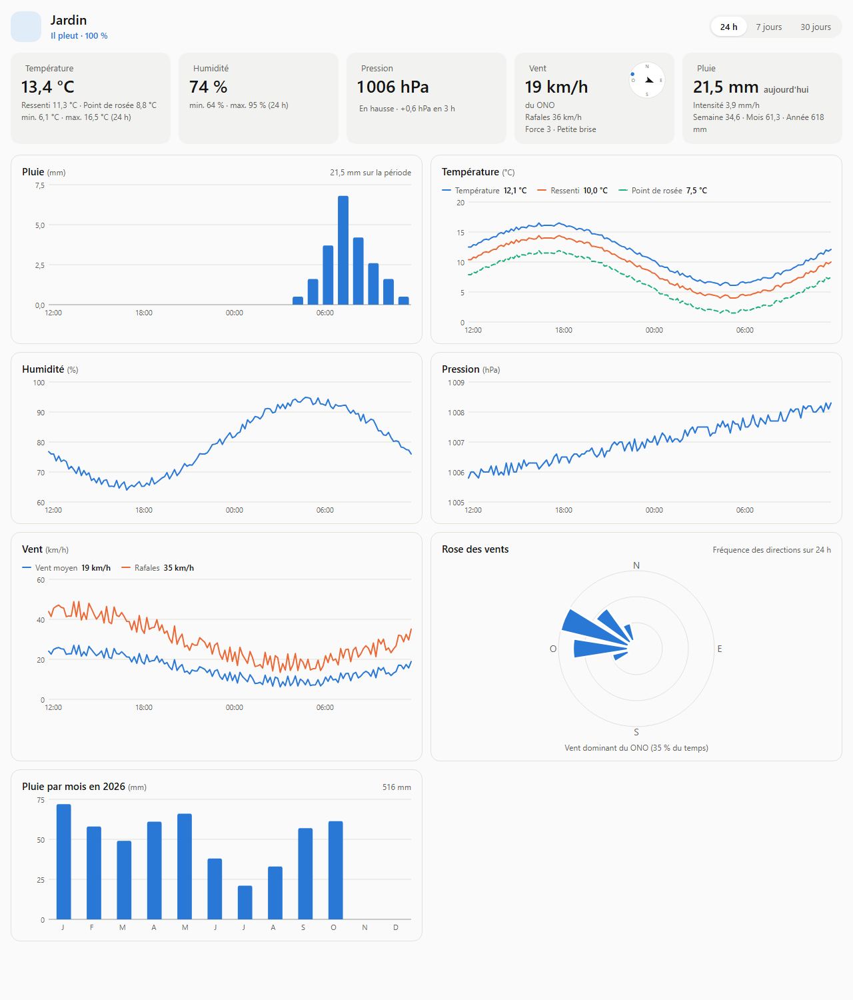

# Weather Station

Intégration Home Assistant (HACS) pour suivre les relevés de votre station météo maison, avec un **tableau de bord** et ses graphiques. Elle est construite autour d'un **pluviomètre à auget basculeur** fait d'un simple capteur d'ouverture (Aqara, Sonoff…) : chaque changement d'état du contact compte un basculement de l'auget. Les autres capteurs sont facultatifs : température, humidité, pression, vent (vitesse, rafales, direction), UV, luminosité et rayonnement solaire.



## Fonctionnalités

- **Tableau de bord** : une entrée **Météo** dans la barre latérale, aussi disponible en carte Lovelace pleine largeur. Il montre :
  - les relevés actuels (minimum et maximum sur 24 h, tendance de la pression sur 3 h, boussole, force Beaufort, niveau UV) ;
  - des graphiques sur **24 h, 7 jours ou 30 jours** : pluie, températures, humidité, pression, vent et rafales, rose des vents, UV et lumière ;
  - la pluie mois par mois de l'année.
- **Cumuls de pluie** : aujourd'hui, semaine (du lundi), mois et année. Ils sont remis à zéro automatiquement et conservés après un redémarrage.
- **Pluie glissante** sur la dernière heure et les dernières 24 h.
- **Intensité de pluie** (mm/h), moyennée sur les derniers basculements.
- **Pluie totale** (`total_increasing`), utilisable dans les statistiques longue durée de Home Assistant.
- **Dernière pluie** (horodatage) et un capteur binaire **Il pleut**.
- **Point de rosée** et **température ressentie**, calculés dès que la température et l'humidité sont renseignées. Le ressenti tient compte du vent.
- **Calibration** (mm par basculement) modifiable à tout moment. Elle s'applique aussi aux cumuls déjà enregistrés.
- **Anti-rebond** facultatif contre les faux contacts.
- **Import de l'historique** à la création : les basculements encore présents dans l'historique de Home Assistant sont repris.
- **Carte compacte** `weather-station-card` en plus du tableau de bord. Les cartes sont chargées automatiquement et ont un éditeur visuel.

## Installation

1. Dans HACS, ajoutez ce dépôt comme *dépôt personnalisé* de type **Intégration** : `https://github.com/elkamy/ha-weather-station`.
2. Installez **Weather Station** puis redémarrez Home Assistant.
3. Allez dans **Paramètres › Appareils et services › Ajouter une intégration › Weather Station**.

Après une mise à jour, redémarrez Home Assistant puis forcez le rechargement de la page (**Ctrl+Maj+R**). Sans cela, le navigateur peut garder les anciennes cartes.

## Configuration

1. **Station** : donnez-lui un nom et choisissez le capteur d'ouverture du pluviomètre (`binary_sensor`). Indiquez ensuite la pluie par basculement.
2. **Autres capteurs** : la batterie du pluviomètre est proposée automatiquement. Tous les autres capteurs sont facultatifs et peuvent être ajoutés plus tard avec **Reconfigurer**. La direction du vent peut être en degrés ou en points cardinaux (`N`, `NE`, `NO`…).

Dans les **options** de l'intégration, on règle la calibration, l'anti-rebond et le délai sans basculement au bout duquel la pluie est considérée comme terminée (30 min par défaut).

### Calibrer le pluviomètre

La valeur par défaut, 0,524 mm par basculement, vient d'un pluviomètre Aqara (41 basculements pour 21,5 mm). Pour mesurer la vôtre, versez lentement un volume d'eau connu `V` (en mL) dans l'entonnoir et comptez les basculements `n`. La surface de l'entonnoir est `S` en cm². La valeur est alors : `mm par basculement = 10 × V / (S × n)`.

## Tableau de bord

L'entrée **Météo** de la barre latérale montre le tableau de bord, avec un onglet par station. On peut aussi l'ajouter à n'importe quel tableau de bord :

```yaml
type: custom:weather-station-dashboard-card
entity: sensor.jardin_pluie_aujourd_hui   # facultatif : première station trouvée sinon
title: Météo du jardin                     # facultatif
period: 24h                                # période affichée à l'ouverture : 24h, 7d ou 30d
```

Les graphiques sur 24 h utilisent l'historique de Home Assistant. Ceux sur 7 et 30 jours utilisent les **statistiques longue durée** (moyenne, avec la plage minimum–maximum pour le premier capteur du graphique). Un capteur n'a de statistiques que s'il déclare une `state_class` : c'est le cas de la plupart des capteurs météo. La rose des vents relit l'historique brut, au plus sur les 7 derniers jours.

## Carte compacte

```yaml
type: custom:weather-station-card
entity: sensor.jardin_pluie_aujourd_hui   # facultatif
title: Météo du jardin                     # facultatif
show_chart: true                           # pluie heure par heure sur 24 h
```

## Entités créées

| Entité | Description |
| --- | --- |
| Pluie aujourd'hui | Cumul du jour (mm). Porte aussi tous les relevés de la station pour les cartes. |
| Pluie cette semaine / ce mois-ci / cette année | Cumuls calendaires (mm) |
| Pluie dernière heure / dernières 24 h | Cumuls glissants (mm) |
| Intensité de pluie | mm/h |
| Pluie totale | Total depuis l'installation (mm, statistiques longue durée) |
| Dernière pluie | Horodatage du dernier basculement |
| Il pleut | Allumé tant qu'un basculement a eu lieu dans le délai de fin de pluie |
| Point de rosée, Température ressentie | °C, avec un capteur de température et un d'humidité |
