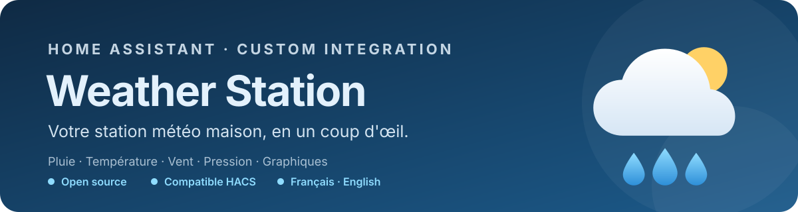

<div align="center">

**Votre station météo maison dans Home Assistant : pluviomètre, température, vent, pression et un tableau de bord avec ses graphiques.**

[](https://my.home-assistant.io/redirect/hacs_repository/?owner=elkamy&repository=ha-weather-station&category=integration)
[](https://github.com/elkamy/ha-weather-station/releases)
[](https://github.com/elkamy/ha-weather-station/commits/main)
[](https://github.com/elkamy/ha-weather-station/stargazers)
[](https://buymeacoffee.com/elkamy)
[](https://github.com/elkamy/ha-weather-station/actions/workflows/validate.yml)
[](https://github.com/elkamy/ha-weather-station/actions/workflows/hassfest.yml)
[](https://github.com/elkamy/ha-weather-station/actions/workflows/hacs.yml)

[](https://my.home-assistant.io/redirect/hacs_repository/?owner=elkamy&repository=ha-weather-station&category=integration)
[](https://my.home-assistant.io/redirect/config_flow_start/?domain=weather_station)

[Ouvrir les issues](https://github.com/elkamy/ha-weather-station/issues) · [Consulter les versions](https://github.com/elkamy/ha-weather-station/releases)

</div>

> **English summary** — Weather Station is a Home Assistant custom integration for a home-made weather station. It turns a contact sensor fitted to a tipping-bucket rain gauge into rain sensors (today, week, month, year, rolling 1 h / 24 h, rate, total, last rain, raining), adds optional temperature, humidity, pressure, wind speed / gust / direction, UV, illuminance and solar radiation sensors, and computes the dew point and feels-like temperature. A "Weather" sidebar panel and a full-width dashboard card show the current readings and charts over 24 hours, 7 or 30 days. The configuration UI and the cards are available in English and French.

Weather Station est une intégration personnalisée Home Assistant pour une station météo maison. Elle est construite autour d'un **pluviomètre à auget basculeur** fait d'un simple capteur d'ouverture (Aqara, Sonoff…) : chaque changement d'état du contact compte un basculement de l'auget. Les autres capteurs de la station sont facultatifs.

<p align="center">
  
</p>

## Fonctionnalités

- **Tableau de bord météo** : une entrée **Météo** dans la barre latérale, aussi disponible en carte Lovelace pleine largeur.
- **Relevés actuels** : minimum et maximum sur 24 h, tendance de la pression sur 3 h, boussole et force Beaufort, niveau UV.
- **Graphiques sur 24 h, 7 jours ou 30 jours**, avec une infobulle au survol : pluie, températures, humidité, pression, vent et rafales, rose des vents, UV, luminosité, rayonnement et pluie mois par mois.
- **Cumuls de pluie** du jour, de la semaine (du lundi), du mois et de l'année, remis à zéro automatiquement et conservés après un redémarrage.
- **Pluie glissante** sur la dernière heure et les dernières 24 h.
- **Intensité de pluie** (mm/h), moyennée sur les derniers basculements.
- **Pluie totale** utilisable dans les statistiques longue durée de Home Assistant.
- **Dernière pluie** et capteur binaire **Il pleut**.
- **Point de rosée** et **température ressentie** calculés dès que la température et l'humidité sont renseignées. Le ressenti tient compte du vent.
- **Calibration** du pluviomètre modifiable à tout moment. Elle s'applique aussi aux cumuls déjà enregistrés.
- **Anti-rebond** facultatif contre les faux contacts.
- **Import de l'historique** à la création, pour ne pas repartir de zéro.
- **Carte compacte** en plus du tableau de bord, avec éditeur visuel.
- Thèmes clair et sombre, interface en français et en anglais.

## Installation

### Avec HACS

1. Assurez-vous que [HACS](https://hacs.xyz/) est installé.
2. Cliquez sur le bouton ci-dessous, ou ouvrez HACS → Intégrations → menu ⋮ → Dépôts personnalisés et ajoutez `elkamy/ha-weather-station` avec la catégorie **Integration**.

   [](https://my.home-assistant.io/redirect/hacs_repository/?owner=elkamy&repository=ha-weather-station&category=integration)

3. Installez **Weather Station** puis redémarrez Home Assistant.
4. Ajoutez l'intégration avec le bouton ci-dessous, ou depuis **Paramètres → Appareils et services → Ajouter une intégration** en recherchant **Weather Station**.

   [](https://my.home-assistant.io/redirect/config_flow_start/?domain=weather_station)

### Installation manuelle

1. Copiez le dossier `custom_components/weather_station` dans `config/custom_components/weather_station`.
2. Redémarrez Home Assistant.
3. Ajoutez l'intégration depuis **Paramètres → Appareils et services**.

Après une mise à jour, redémarrez Home Assistant puis forcez le rechargement de la page (**Ctrl+Maj+R** dans le navigateur ; dans l'application mobile, **Paramètres de l'application → Débogage → Réinitialiser le cache du frontend**). Sans cela, le navigateur peut garder les anciennes cartes.

## Configuration de la station

L'ajout d'une station se fait en deux étapes :

1. **La station** : donnez-lui un nom, choisissez le capteur d'ouverture du pluviomètre (`binary_sensor`) et indiquez la pluie par basculement. Gardez **Importer l'historique** coché pour reprendre les basculements déjà enregistrés par Home Assistant (10 jours par défaut).
2. **Les autres capteurs**, tous facultatifs :
   - la batterie du pluviomètre, proposée automatiquement ;
   - température, humidité et pression ;
   - vitesse, rafales et direction du vent (la direction peut être en degrés ou en points cardinaux : `N`, `NE`, `NO`…) ;
   - indice UV, luminosité et rayonnement solaire.

Vous n'avez pas encore tous vos capteurs ? Ajoutez-les plus tard avec **Reconfigurer** depuis la carte de l'intégration. Le tableau de bord n'affiche que les relevés disponibles.

Dans les **options** de l'intégration, on règle :

| Option | Rôle | Par défaut |
| --- | --- | --- |
| Pluie par basculement | Quantité de pluie (mm) d'un basculement de l'auget | 0,524 mm |
| Anti-rebond | Ignore un basculement trop proche du précédent (faux contact) | 0 s (tout compter) |
| Fin de pluie après | Délai sans basculement au bout duquel la pluie est terminée | 30 min |

### Calibrer le pluviomètre

La valeur par défaut, 0,524 mm par basculement, vient d'un pluviomètre Aqara (41 basculements pour 21,5 mm). Pour mesurer la vôtre :

1. Versez lentement un volume d'eau connu `V` (en mL) dans l'entonnoir.
2. Comptez les basculements `n`.
3. Mesurez la surface de l'entonnoir `S` (en cm²).

La valeur est alors : `mm par basculement = 10 × V / (S × n)`.

## Tableau de bord

L'entrée **Météo** de la barre latérale montre le tableau de bord, avec un onglet par station. Il existe aussi en carte Lovelace, à ajouter depuis **Ajouter une carte → Tableau de bord météo** ou en YAML :

```yaml
type: custom:weather-station-dashboard-card
entity: sensor.jardin_pluie_aujourd_hui   # facultatif : première station trouvée sinon
title: Météo du jardin                     # facultatif
period: 24h                                # période à l'ouverture : 24h, 7d ou 30d
```

<p align="center">
  
</p>

- **24 h** : les graphiques reprennent l'historique brut de Home Assistant, et la pluie est affichée heure par heure.
- **7 et 30 jours** : les graphiques utilisent les **statistiques longue durée** (moyenne horaire ou journalière). Le premier capteur de chaque graphique montre aussi sa plage minimum–maximum. La pluie est affichée jour par jour.
- **Rose des vents** : part du temps passé dans chaque direction, sur 24 h ou sur les 7 derniers jours.

Un capteur n'a de statistiques longue durée que s'il déclare une `state_class`. C'est le cas de la plupart des capteurs météo et de ceux créés par l'intégration.

## Carte compacte


La carte `weather-station-card` résume une station : pluie du jour et intensité, cumuls sur 1 h, 24 h, la semaine, le mois et l'année, pluie heure par heure et les autres capteurs.

```yaml
type: custom:weather-station-card
entity: sensor.jardin_pluie_aujourd_hui   # facultatif
title: Météo du jardin                     # facultatif
show_chart: true                           # pluie heure par heure sur 24 h
```

<br clear="right">

## Entités créées

| Entité | Description |
| --- | --- |
| Pluie aujourd'hui | Cumul du jour (mm). Porte aussi tous les relevés de la station pour les cartes. |
| Pluie cette semaine / ce mois-ci / cette année | Cumuls calendaires (mm) |
| Pluie dernière heure / dernières 24 h | Cumuls glissants (mm) |
| Intensité de pluie | mm/h |
| Pluie totale | Total depuis l'installation (mm, statistiques longue durée) |
| Dernière pluie | Horodatage du dernier basculement |
| Il pleut | Allumé tant qu'un basculement a eu lieu dans le délai de fin de pluie |
| Point de rosée, Température ressentie | °C, avec un capteur de température et un capteur d'humidité |

## Désinstallation

1. Supprimez les cartes Weather Station de vos tableaux de bord.
2. Supprimez chaque station depuis **Paramètres → Appareils et services → Weather Station**. L'entrée **Météo** disparaît avec la dernière station.
3. Désinstallez Weather Station depuis HACS (ou supprimez `config/custom_components/weather_station`), puis redémarrez Home Assistant.

## Développement et tests

Les tests automatisés couvrent la logique du pluviomètre, les formules météo, les capteurs et le rendu des cartes.

Exécuter les tests localement :

```bash
python -m compileall -q custom_components/weather_station tests
python -m unittest discover -s tests -v
node --check custom_components/weather_station/www/weather-station-card.js
node --check custom_components/weather_station/www/weather-station-dashboard.js
node --test tests/test_card.js tests/test_dashboard.js
```

Les tests de `tests_ha/` s'exécutent dans un vrai Home Assistant (flux de configuration, entités, import de l'historique, panneau) :

```bash
pip install pytest-homeassistant-custom-component
python -m pytest
```

La CI vérifie également les métadonnées JSON, HACS et Hassfest. Pour signaler un bug ou demander une fonctionnalité, [ouvrez une issue](https://github.com/elkamy/ha-weather-station/issues).

## Compatibilité

- Intégration personnalisée Home Assistant.
- Version minimale déclarée : Home Assistant 2024.11.0.
- Installation et mises à jour via HACS ou manuellement.

## Licence

Distribué sous licence MIT. Consultez le fichier [LICENSE](LICENSE).
